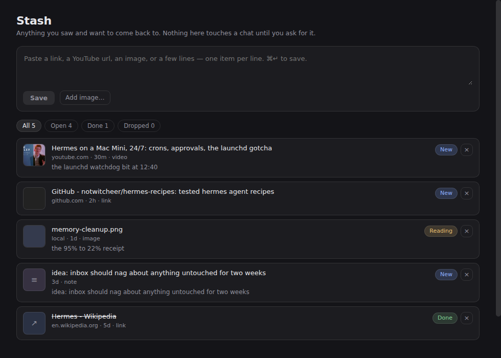

# Stash

A capture bin for your Hermes sidebar.

You see something — a post, a repo, a video, a screenshot, a half-thought — and you want it
later without it living in your chat history. Paste it into Stash and leave. Come back whenever,
or ask your agent to go through it.

Links, YouTube urls, image urls, uploaded images and plain text all go in the same box. Titles and
thumbnails fill in on their own, fetched server-side, so nothing costs you a model call.



## Install

Install it on the machine that runs the **desktop app** — the app copies a package's desktop half
out of that machine's `~/.hermes/plugins/`, so a copy installed on a remote server never reaches
your sidebar.

```bash
hermes plugins install RegeneratusLabs/hermes-stash
hermes plugins enable stash
```

The desktop half ships **off** by design (a package's UI half mirrors its agent half's consent).
So there is one click left after the two commands: restart the app, then **Capabilities → Plugins →
Stash → enable**. Stash then appears in the left sidebar, under your other plugin pages.

From a clone instead:

```bash
git clone https://github.com/RegeneratusLabs/hermes-stash.git
cd hermes-stash
./install.sh
```

## Using it

- **Paste anything** into the box at the top. One item per line, so a whole block of links becomes
  several items.
- **Drag an image in**, pick one with *Add image…*, or ⌘V a screenshot straight into the box.
- **Statuses**: New → Done → Dropped. Click the pill to move an item along.
- **Filters** count what's in each state.
- Click a title to try opening the link; your agent can open anything that refuses.

## Letting the agent do the work

Three tools ship with the plugin, so this works from any conversation:

| tool | what it does |
|---|---|
| `stash_add` | save links or notes to Stash mid-chat |
| `stash_list` | read what's waiting (open items by default) |
| `stash_update` | mark something done or dropped once it's handled |

So *"stash this for later"* and *"go through my stash and file what's worth keeping"* both work.

## Where things live

- Items: `~/.hermes/stash/items.json` — plain JSON, one file, safe to edit by hand.
- Uploaded images: `~/.hermes/stash/media/`.
- The page talks to the backend at `/api/plugins/stash/`.

Nothing is summarised, uploaded or sent anywhere. Title lookups are ordinary page fetches against
the url you saved.

## Requirements

Hermes Agent with desktop plugin support. Python side uses only the standard library plus what
Hermes already ships (FastAPI). No API keys.

## When it installs but never appears

Three traps, in the order they bite:

1. **Install it on the machine the app runs on.** The app reads its own
   `~/.hermes/desktop-plugins/`, never the backend's (Electron-local, `#66899`), and a package
   installed only on a remote backend can never materialise a desktop half (`#114079`). A terminal
   *inside* the app is the backend's shell, not your laptop's.
2. **The search box in Capabilities → Plugins searches the catalog, not what's installed.** Typing
   there will never show a locally installed plugin. Clear it to see the installed list.
3. **`.hermes-package.json` next to the desktop half means "off".** The app writes that marker when
   it copies a package's half, and a marker sets `defaultEnabled: false` — the UI half mirrors the
   Python half's consent gate. Either flip the Desktop switch on the plugin's row, or drop the
   marker so it loads enabled by default:
   `rm -f ~/.hermes/desktop-plugins/stash/.hermes-package.json`

## Credit

Built by Josh Thomson with Hermes Agent, which wrote most of it in one sitting. The store is plain
JSON on purpose: a capture bin should outlive the app that made it.

## Licence

MIT — see [LICENSE](LICENSE).
